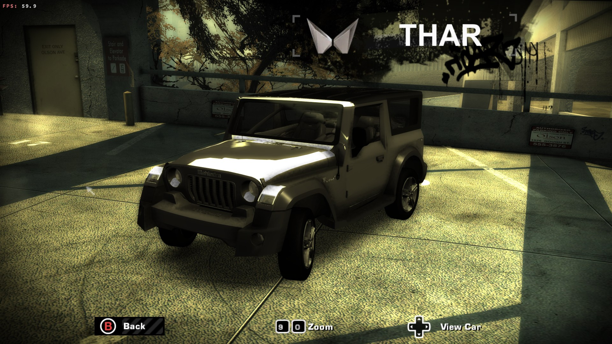
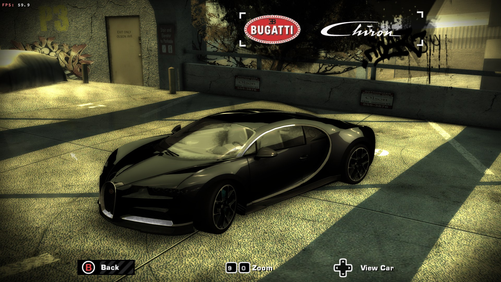
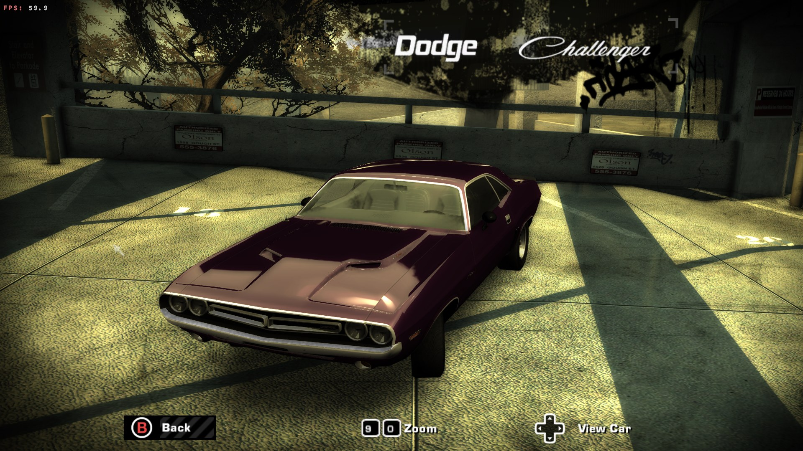
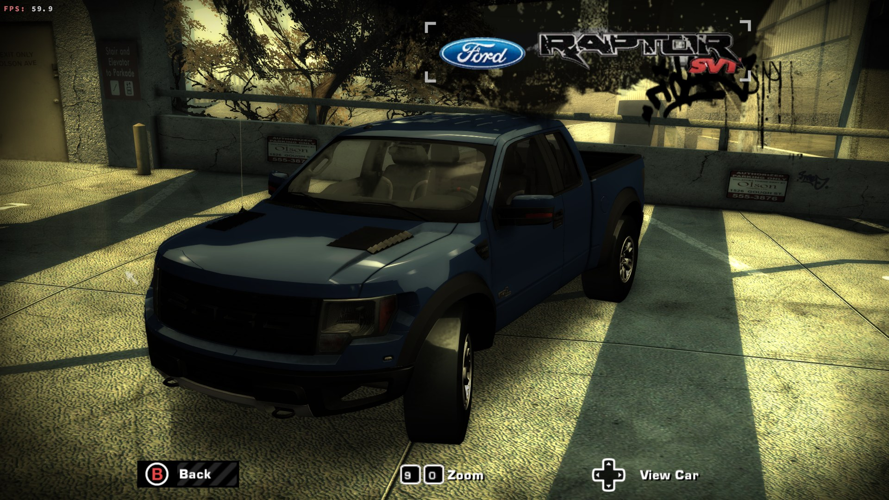
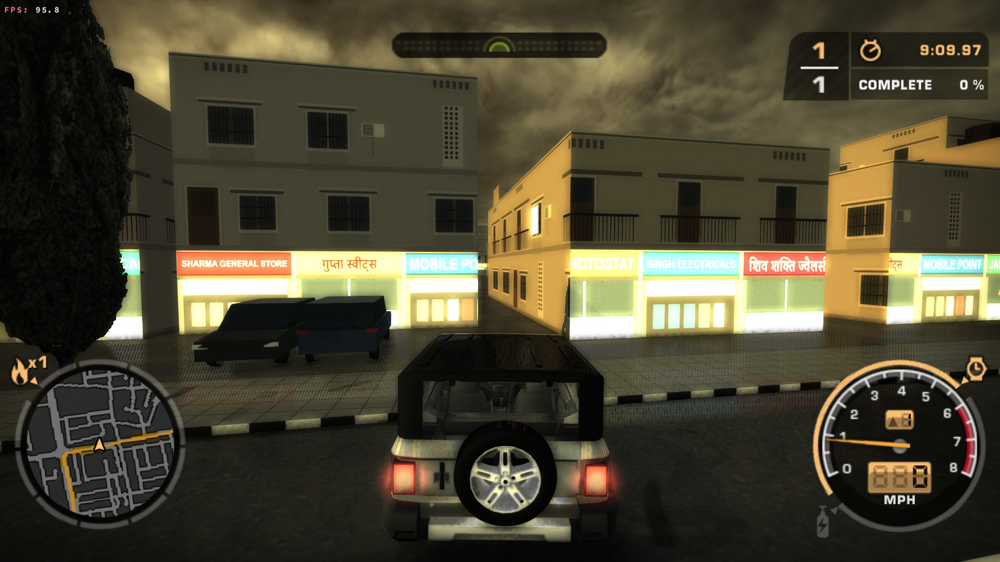
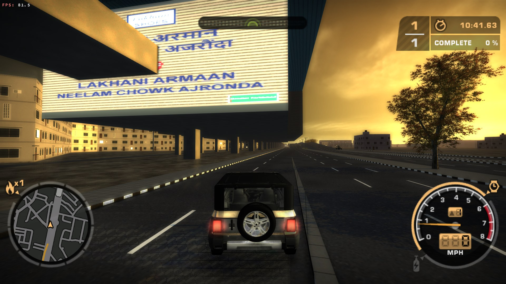
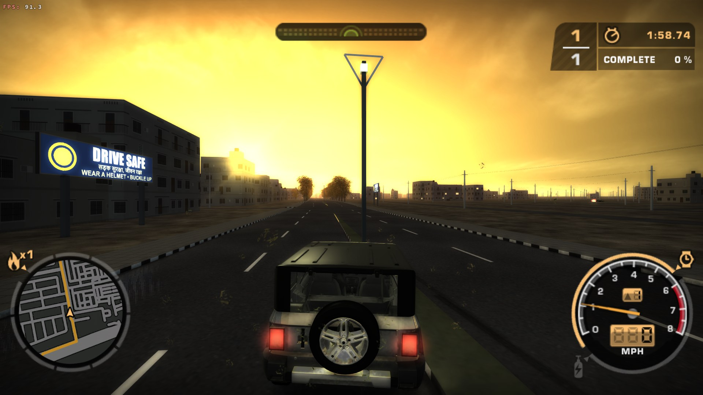
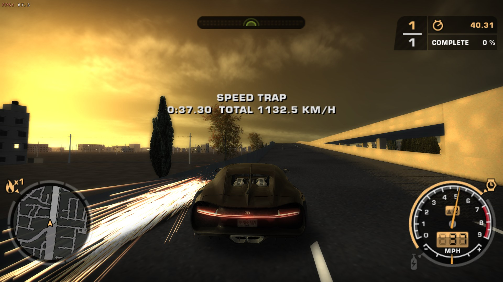
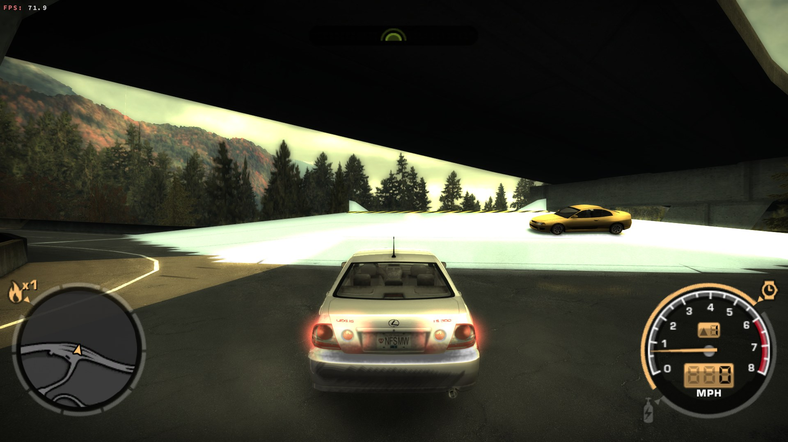

# NFSMW F-Town Edition

A mod for **Need for Speed Most Wanted (2005, PC)**: a new map built from OpenStreetMap (F-Town), a car made for the
game from a CC-BY model (the Mahindra Thar), the Xbox 360 look with picture effects of our own, controller and rumble
support, and your own songs in the game's playlist. This repository is its source; the playable package (installer
and our files) is published separately on the mod sites.

None of EA's files and no other modder's files are in this repository or in the package: the installer applies the
player's own downloads of other authors' mods, pinned by SHA-256 to their official releases.

**Download:** [GitHub release v1.0.0](https://github.com/BugCrush/nfsmw-ftown-edition/releases/tag/v1.0.0) ·
[Nexus Mods](https://www.nexusmods.com/needforspeedmostwanted2005/mods/356)

## The parts

| Part | What it does | Source |
|---|---|---|
| InputBridge | Xbox controller with separate triggers, rumble, steering curve | `input/src` |
| MusicBridge | Your own MP3s in the game's playlist; next song while driving | `music/src` |
| VisualBridge | Ambient occlusion, light shafts, distance haze, wet roads, edge smoothing, world shadows back on | `visual/src` |
| ReflectRate | Redraws half of the car-reflection faces per frame (frame rate) | `reflect/src` |
| PatchMap | Logs which plugin patched which game address (conflict reports) | `tools/diag` |
| CarStable | Keeps profiles loading when cars are added or removed | `cars/src` |
| FTownLoader | Loads F-Town into the game: world, collision, traffic, events, minimap, the road from Rockport | `ftown/src` |
| F-Town builder | OpenStreetMap and elevation to the game's world format | `tools/citymap`, `tools/world` |
| Car builder | A 3D model (Blender) to the game's car files; the Thar | `tools/carbuild`, `tools/cars/packages/thar` |
| Install code | The Xbox 360 Stuff Pack stages, add-on cars, ReTex, as reused by the installer | `tools/x360`, `tools/cars`, `tools/textures` |
| Companion builds | Build scripts for the open-source plugins the package includes | `companions` |
| Installer | Finds the player's downloads by content, checks the game, installs with a byte-exact uninstall | `release/installer` |
| Diagnostics | GfxProbe, WorldProbe, FpsRecorder, ExitTrace (not in the package) | `gfx`, `world`, `fps-capture`, `tools/diag` |

## Screenshots

| | | |
|---|---|---|
|  |  |  |
|  |  |  |
|  |  |  |

## Building

- **Plugins** (32-bit `.asi`): Zig 0.16.0 (`zig.exe` in `.tools/zig/`). From PowerShell, in a part's `src` folder:
  `.\build.bat ..\..\.tools\zig\zig.exe`. Copy the `.asi` into the game's `scripts` folder with the game closed.
- **Companions:** `companions/README.md` (Zig, or MSBuild from Visual Studio Build Tools for the Widescreen Fix and
  AeroWidescreen's plugins).
- **Installer and package:** Python 3.10 with `release/requirements.txt` (PyInstaller, PyYAML):
  `python release/build_package.py` builds `release/dist/NFSMW F-Town Edition/` and its zip.
- **Tests:** each part has stand-in programs that mimic the game's calls (`*/tests/`); the installer's tests run with
  `python release/tests/run.py` (synthetic game folders).

## Using the installer

See the package's `README.txt` (`release/package/README.txt`): download the listed mods into one folder, then
`FTownEditionInstaller.exe install --game <game folder> --downloads <folder>`; `uninstall` restores every game file
byte for byte.

## Credits

`release/package/CREDITS.txt` lists every author, licence and link. In short: map data (c) OpenStreetMap
contributors (ODbL); Thar model by aakash2__2 (Blend Swap 31849, CC-BY); the game decompilation
[dbalatoni13/nfsmw](https://github.com/dbalatoni13/nfsmw) (CC0) for addresses; ThirteenAG's Widescreen Fix and ASI
Loader (MIT); DXVK (zlib); AeroWidescreen's NFSHDReflections and NFSMWFEShadows, R-033's TexWizard (GPL-3.0); the
Xbox 360 Stuff Pack by elaymm4 and contributors; nlgxzef's Unlimiter, Binarius and add-ons; NFSTools' Attribulator.

## Licence

MIT (`LICENSE`) for our own code and data. Third-party pieces keep their own licences.

Built with [Claude Code](https://claude.com/claude-code).
